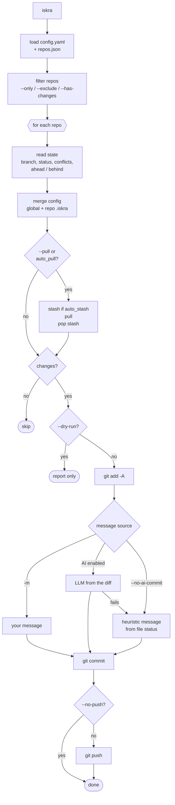
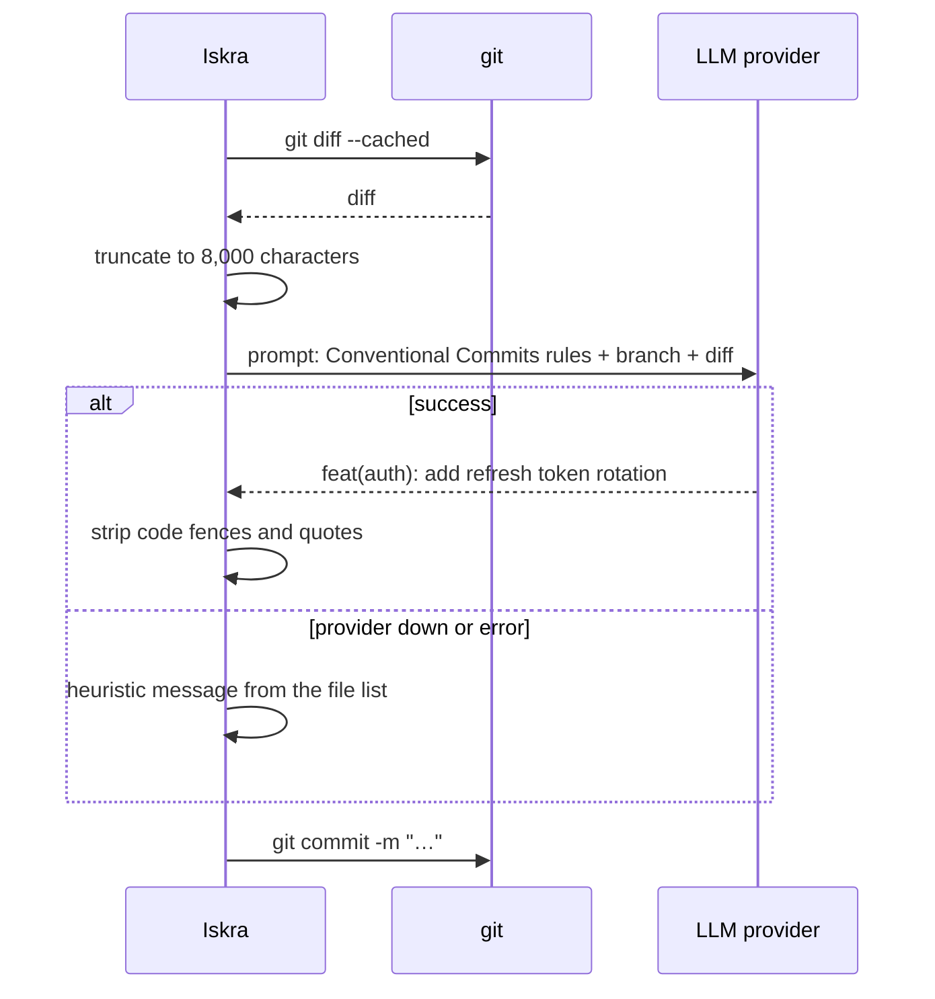

<div align="center">

<h1>Iskra</h1>

<p><strong>Git across every repository, from one binary.</strong></p>

<p>
  <a href="https://github.com/NoamFav/Iskra/releases"></a>
  <a href="https://github.com/NoamFav/Iskra/actions/workflows/ci.yml"></a>
  
  
  <a href="LICENSE"></a>
</p>

<p>
  <a href="#why">Why</a> ·
  <a href="#how-it-works">How it works</a> ·
  <a href="#installation">Installation</a> ·
  <a href="#usage">Usage</a> ·
  <a href="#ai-commit-messages">AI commits</a> ·
  <a href="#configuration">Configuration</a>
</p>

</div>

Iskra manages Git across many repositories at once. One command checks every repository you
track, commits whatever changed with a well-formed message, and pushes. Around that core it
offers a status overview, bulk pull and clone, a command runner for all repos, and guided
helpers for the fiddly single-repo operations (rebase, fixup, cherry-pick, tag).

It is a single static Go binary with no runtime dependencies beyond `git`. It is the successor
of [Zvezda](https://github.com/NoamFav/Zvezda), which needed Python and Go side by side.

## Why

With a few dozen repositories (projects, dotfiles, notes, experiments), the end of a work
session looks like this, over and over:

```bash
cd ~/code/project-a && git add -A && git commit -m "wip" && git push
cd ~/code/project-b && git status   # forgot this one had changes yesterday
...
```

The result is skipped repos, unpushed work and a history full of `wip`. Iskra replaces the
loop with one command, and replaces `wip` with a
[Conventional Commit](https://www.conventionalcommits.org/) message written from the actual
diff.

## How it works

Iskra keeps a list of tracked repositories in `~/.config/iskra/repos.json`. Running `iskra`
walks that list and runs the same pipeline in each repository:



Each repository produces a structured result (status, operations performed, commit hash,
errors, timing), which Iskra prints as a summary or emits as JSON with `--json`. One failing
repository never stops the batch.

The internals are described in [docs/architecture.md](docs/architecture.md):

| Package | Responsibility |
| --- | --- |
| `cmd/iskra` | Command routing and flags |
| `internal/config` | Global config, per-repo `.iskra` overrides, tracked-repo list |
| `internal/scanner` | Finding Git repositories on disk |
| `internal/processor` | The per-repo pipeline above |
| `internal/ai` | Commit messages from Ollama, OpenAI or Claude, plus the heuristic fallback |
| `internal/batch` | Multi-repo commands: commit, status, sync, exec |
| `internal/pulse` | Single-repo helpers |
| `internal/remote` | Git and GitHub CLI wrappers |
| `internal/info` | The `iskra info` repository card |
| `internal/ui` | Terminal styling (Lip Gloss) |

## Installation

Download a prebuilt binary (no Go needed). It installs to `~/.local/bin`:

```bash
curl -fsSL https://raw.githubusercontent.com/NoamFav/Iskra/main/script/install.sh | bash
```

Or build from source (Go 1.24+):

```bash
git clone https://github.com/NoamFav/Iskra.git
cd Iskra
make install
```

Prebuilt archives for macOS and Linux (amd64 and arm64) are on the
[Releases](https://github.com/NoamFav/Iskra/releases) page.

| Dependency | Needed for |
| --- | --- |
| `git` | Everything |
| [Ollama](https://ollama.com) | AI messages with the default, local provider |
| [`gh`](https://cli.github.com) | `iskra gh` and `iskra clone` |
| [`git-filter-repo`](https://github.com/newren/git-filter-repo) | `iskra pulse filter` only |

## Usage

### First run

```bash
iskra init ~/code    # find every Git repository under ~/code and track it
iskra list           # check what is tracked
iskra status         # overview: branch, changes, ahead/behind for each repo
iskra                # commit and push everything that changed
```

### Everyday commands

| Command | What it does |
| --- | --- |
| `iskra` | Commit and push every tracked repo that has changes |
| `iskra --dry-run` | Show what would be committed, change nothing |
| `iskra --pull --only api,web` | Pull, then commit, only in repos matching `api` or `web` |
| `iskra -m "chore: bump deps"` | Use one message for every repo instead of generating them |
| `iskra status` (`s`) | Status of every tracked repo |
| `iskra sync-all` | Pull every tracked repo |
| `iskra exec "git fetch --all"` | Run any command in every tracked repo |
| `iskra check` | Untrack repos that no longer exist on disk |
| `iskra info` | A repository card: languages, contributors, recent commits, upstream |
| `iskra log`, `diff`, `branches`, `stash` | Readable views of the current repo |

### Single-repo helpers: `iskra pulse`

`iskra pulse` on its own commits and pushes the current repository. Its subcommands wrap Git
operations that are easy to get wrong:

| Command | What it does |
| --- | --- |
| `pulse switch [branch]` | Pick, create or delete a branch interactively |
| `pulse rebase [base]` | Guided rebase, with recovery hints on conflict |
| `pulse fixup [hash]` | Fold staged changes into an earlier commit |
| `pulse cherry-pick [hash]` | Pick commits from an interactive log |
| `pulse reset [file]` | Discard staged, unstaged or all changes |
| `pulse tag [name]` | Create, list, delete and push tags |
| `pulse blame <file>` | Per-line authorship, colored by author |
| `pulse filter --remove-path <path>` | Remove a path from history (needs `git-filter-repo`) |

### GitHub

```bash
iskra gh info                                # stars, watchers, open issues
iskra gh prs                                 # open pull requests
iskra gh prs --open 42                       # open PR #42 in the browser
iskra clone ~/code --filter-forks --only-stars 5
```

### Flags

<details>
<summary><code>iskra help</code></summary>

```text
GLOBAL FLAGS:
    -h, -help       Show help
    -v, -version    Show version
    -json           Output JSON
    -minimal        No colors or icons
    -q, -quiet      Quiet mode

COMMIT FLAGS:  (for 'iskra commit' or 'iskra' directly)
    -status-only    Only show status
    -pull-only      Only pull
    -pull           Pull before commit
    -no-push        Don't push after commit
    -no-ai-commit   Don't use AI
    -m <message>    Custom commit message
    -dry-run        Preview without changes

FILTER FLAGS:  (for 'iskra commit' or 'iskra' directly)
    -only <pattern>    Only include matching repos
    -exclude <pattern> Exclude matching repos
    -c, -has-changes   Only repos with changes
```

Flags accept one or two dashes (`-dry-run` or `--dry-run`). Run `iskra <command> -h` for
command-specific flags, or `man ./iskra.1`.

</details>

### Scripting

`--json` turns any batch command into machine-readable output, and `--minimal` drops colors
and icons for CI logs:

```bash
iskra status --json | jq -r '.results[] | select(.changes.total > 0) | .name'
```

## AI commit messages



The prompt asks for a single Conventional Commit subject line, chooses the type from what the
diff actually does (`feat`, `fix`, `refactor`, `docs`, `chore`…), and tells the model to
describe only what it can see if the diff was truncated.

| Provider | Setup | Default model |
| --- | --- | --- |
| Ollama (default, local) | `ollama pull mistral` | `mistral` |
| OpenAI | `ai_provider: openai`, `OPENAI_API_KEY` | `gpt-4o-mini` |
| Claude | `ai_provider: claude`, `ANTHROPIC_API_KEY` | `claude-sonnet-4-6` |

If generation fails, Iskra writes a message from the changed files instead (for example
`docs: update README.md`, `chore: update config files` or `feat: add parser.go`) and tells
you why the AI step failed. A commit is never blocked by the model.

## Configuration

The global config is created on first run at `~/.config/iskra/config.yaml`. Every key is
optional:

```yaml
# Discovery
base_dir: ~/projects          # default directory for `iskra init`
max_depth: 3                  # how deep to look for repositories
exclude_patterns: []
only_patterns: []

# Git behavior
default_branch: main
protected_branches: [main, master, production]   # flagged in output
auto_pull: true
auto_push: true
auto_stash: false             # stash before pulling, pop afterward

# Commit messages
use_ai_commit: true
commit_message_style: conventional   # or: simple
ai_provider: ollama                  # ollama, openai or claude
ollama_url: http://127.0.0.1:11434
ollama_model: mistral

# Output
use_rich_ui: true
verbose: false
```

### Per-repository overrides

A `.iskra` file at a repository root marks it as tracked and overrides global settings for
that repository only:

```yaml
auto_push: false
use_ai_commit: false
protected_branches: [main, develop]
commit_message_style: simple
```

## Development

```bash
make build    # bin/iskra, version injected from the Git tag
make lint     # go vet
make help     # every target
```

CI runs `go vet`, a build and a smoke test on every push. Tagging `v*` builds and publishes
binaries for four platforms. See [CONTRIBUTING.md](CONTRIBUTING.md) and the
[changelog](CHANGELOG.md).

## License

Licensed under the [Apache License 2.0](LICENSE). See [NOTICE](NOTICE) for copyright
and attribution notices.
